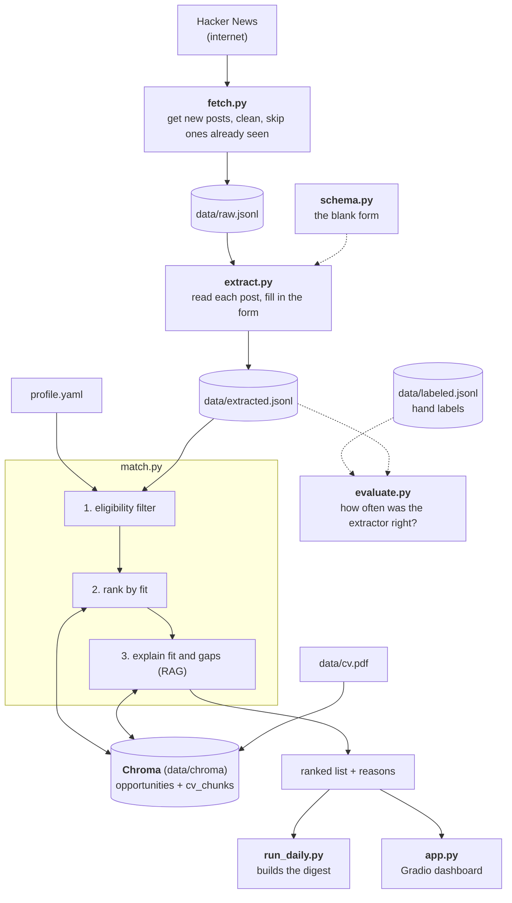

# Opportunity Finder

> Stop scrolling for opportunities. A pipeline that keeps watching the places where opportunities are posted, throws away the noise, and delivers the ones you can actually apply to, ranked by fit, before they are gone.

**Status:** Proof of concept, Week 1 (data inspection done on a first sample of 5 Hacker News posts).
**Author:** Irene, built step by step as a hands-on project for an LLM engineering course.

---

## 1. Problem

Many opportunities (jobs, internships, fellowships) are announced as **feed posts**, especially on LinkedIn, rather than on the jobs page. Someone who is job hunting ends up scrolling the feed for hours, wading through posts that are not opportunities, and still:

- **misses** opportunities that scrolled past unnoticed,
- finds others **too late**, after the application window has closed,
- reads a whole post only to learn that it is for a seniority level or location that does not fit.

Why this is hard to automate:

1. **Mostly noise.** Most posts in a feed are not opportunities at all.
2. **No structure.** Every post is written differently, so there are no searchable fields (role, location, deadline).
3. **Buried requirements.** Seniority, location rules and visa wording are scattered through free text: *Remote (US only)*, *Senior*, *We can't sponsor visas*. Reading them post by post is slow.
4. **Timing.** Value is lost when a post is found late, so collection has to be continuous, not occasional.

## 2. Solution

A pipeline that **runs on a schedule**, so you don't have to go looking:

1. **Collect:** on a schedule, pull new posts from the sources where opportunities appear.
2. **Detect:** discard everything that is not an opportunity.
3. **Extract:** turn each opportunity into structured fields (role, company, location, remote rules, visa, salary, deadline, how to apply).
4. **Apply preferences (optional):** if the user set any hard preferences (e.g. only remote, no onsite), filter on them. Off by default.
5. **Rank:** how well does it fit the user's CV?
6. **Deliver:** send a short digest of new, ranked opportunities, each with a one-line reason it fits and what is missing.

## 3. What the final product is

**An opportunity feed that fills itself.** You upload your CV once, plus any preferences you want enforced (roles you want, remote-only, languages). From then on:

- A **scheduler** runs the pipeline automatically (daily for the PoC).
- You receive a **digest of new opportunities only**: ranked by fit, each with the key fields, the apply link and a short "fits because / missing" note.
- A **Gradio dashboard** lets you browse the collected pool, search it, adjust your profile and see why something was ranked where it was.

**Sources are pluggable.** Each source is a small adapter that returns raw posts in one common format; everything after that is the same pipeline.

| Source | Role |
|---|---|
| Hacker News "Who is hiring?" | PoC stand-in for a feed: public, free API, a new thread every month |
| Later: job-alert emails, public Telegram channels, RSS (e.g. ReliefWeb), company career pages | Permitted, automatable sources for the real product |
| LinkedIn feed | **Open problem.** LinkedIn offers no sanctioned way to read the feed automatically, and scraping it risks account bans and breaks its Terms of Service. The design leaves a slot for it (see Limitations) but does not depend on it. |

A "share a post to the tool" option can exist as a small fallback adapter for posts that no automatic source reaches, but it is not the product.

## 4. What the real data looks like

First look at 5 real posts from *Ask HN: Who is hiring? (October 2026)*. This is a small sample, so treat these as hypotheses to confirm on 50+ posts.

| Observation | Example in the data | Design consequence |
|---|---|---|
| Header formats are inconsistent | `Shepherd (Series B) \| ONSITE \| San Francisco...` vs `PrairieLearn (Remote US) — Full-Stack Software Engineer — ...` | Rules and regexes are not enough. Use an LLM extractor. |
| **One post, several roles** | Shepherd lists 4 role types across 2 cities; Sidekick lists 3; Neon lists 4 | Schema is *company-level fields + a list of roles*, not one flat record. |
| **Remote has a scope** | `Remote (US only)`, `REMOTE (Germany)`, `REMOTE (US Timezones)` | Extract `remote_scope` as written, so the digest can show it. |
| Visa and residency rules are in free text | "We're not able to sponsor visas", "You must be based in Germany", "no visa sponsorship" | Extract `visa_sponsorship` (often "unclear": only ~5% of posts mention visas). |
| Language requirements | A Dutch post that says Dutch is *strictly required*; a German post requiring business-fluent German | Extract `language_required`; detect post language. |
| Salary is sometimes there, in different currencies | `$100k-$180k`, `€75k–80k`, `$170k to $230k Base + Equity` | Store min, max, currency as optional fields. |
| Apply instructions vary | Web form, email with a subject-line rule, "mention you heard via HN" | Extract `apply_method` and `apply_target`. |
| Fields that are often absent | Deadline appears in none of the five | Every field must be allowed to be `null`. The extractor must never invent values. |
| Not every post is English | One post switches to Dutch mid-text | The pipeline cannot assume English. |

Replies are mostly empty (`n_replies` is 0 on 4 of 5), so top-level comments are clean job posts and we ignore replies.

## 5. Extraction schema (v0, will change after labeling)

```
Post
├── is_opportunity: bool
├── post_language: str
├── company: str
├── company_stage: str | null          (e.g. "Series B", "bootstrapped")
├── remote_policy: remote | hybrid | onsite | unclear
├── remote_scope: str | null           (e.g. "US only", "Germany")
├── visa_sponsorship: yes | no | unclear
├── language_required: list[str]
├── apply_method: url | email | other
├── apply_target: str
├── deadline: date | null
└── roles: list[Role]
      ├── title: str
      ├── seniority: str | null
      ├── location: str | null
      ├── employment_type: str | null
      ├── salary_min / salary_max / currency: optional
      └── skills: list[str]
```

This is a starting point. After hand-labeling 50 posts we will see which fields are reliably present and which are noise, and trim or add fields.

## 6. Architecture

```
 [Scheduler]  runs the whole pipeline daily
        ▼
 [Source adapters]  HN today; email / Telegram / RSS later
        ▼
  clean + de-duplicate (skip posts already seen)  ──► raw posts (JSONL)
        ▼
  [Classifier]  is it an opportunity?            (noise is dropped here)
        ▼
  [LLM extractor]  post ──► structured JSON      (schema above, validated)
        ▼
  structured opportunities  ──►  [Embed] ──► Chroma
                                              ▲
  User profile: CV + constraints ──► embed ───┤
        ▼                                     │
  [Preference filter]  optional hard rules (remote only, language, ...), off by default
        ▼
  [Semantic ranking]  nearest opportunities to the CV
        ▼
  [RAG explanation]  LLM sees CV chunks + the post ──► "fits because..., missing..."
        ▼
  [Delivery]  daily digest (email / message) + Gradio dashboard
```

Design decisions worth noting:

- **Only new posts move forward.** The store remembers every post ID it has seen, so each run delivers only what is new. This is what prevents "found it too late" and repeated alerts.
- **Hard rules are not similarity scores.** If a user sets a hard preference (say, remote only), it is applied as a filter before ranking, never as part of the similarity score. Seniority is different: it is a strong signal for ranking, since most posts are for senior roles.
- **Evaluation is built in, not added at the end.** Every stage is measured against hand-labeled data.

## 7. Tools and where each course topic is used

| Course topic | Where it is used |
|---|---|
| **Tokenizers / AutoTokenizer** | Measure post length in tokens; check posts fit the model's context; choose chunk sizes for the CV; understand why long multi-role posts cost more. |
| **Hugging Face pipelines** | A zero-shot or fine-tuned classifier for "is this an opportunity?", and a baseline to compare against the LLM approach. |
| **LangChain** | Structured-output extraction chain (prompt, model, validated schema); the CV-to-opportunity explanation chain. |
| **Tools** | Small helper tools the LLM can call, e.g. a salary-currency normalizer or a link checker. |
| **Embeddings + Chroma (RAG)** | Index opportunities and the CV; retrieve the best matches and the relevant CV passages for the explanation. |
| **Gradio** | The dashboard: browse the pool, edit the profile, see why something ranked where it did. |
| Plain Python + a scheduler (cron or GitHub Actions) | Source adapters, cleaning, de-duplication, the daily run, the digest, evaluation scripts. |

## 8. Data plan

| Source | Used for | Why |
|---|---|---|
| **Hacker News "Who is hiring?" threads** | Main source: building and measuring the extractor | Public, free API, real messy text, one post = one opportunity |
| **Bluesky posts** | Negative examples for the classifier ("not an opportunity") | Real social-media text that is not job-related |
| **Synthetic LinkedIn-style posts** | Testing robustness to feed-style writing | Generated from Kaggle LinkedIn job rows where the true fields are known |
| **30–50 posts copied by hand from my own feed** | Final honest test | The real target format; kept out of all tuning |

Hacker News API (no key needed):
- Find threads: `https://hn.algolia.com/api/v1/search_by_date?tags=story,author_whoishiring`
- Get a whole thread: `https://hn.algolia.com/api/v1/items/<story_id>`

## 9. Step-by-step plan

Each step has one thing to build and one thing to learn. We finish and check a step before the next.

| Step | Build | Learn / check |
|---|---|---|
| **1. Look at the data** (done on 5 posts) | `hn_fetch.py`: fetch a thread, clean, save JSONL | HTML cleaning; reading real data before designing |
| **2. Collect** | Fetch ~6 monthly threads; basic stats | Dataset sizes; token counts with a tokenizer |
| **3. Label** | Hand-label 50 posts against the schema | Where the schema breaks; what "ground truth" costs |
| **4. Extract** | LangChain extractor with a validated schema; score it field by field | Structured output; prompt iteration; measuring instead of eyeballing |
| **5. Match** | Embed CV and extracted summaries into Chroma; optional preference filter; ranked list | Embeddings, retrieval, hard filters vs similarity |
| **6. Explain** | RAG explanation of fit and gaps | Retrieval-augmented generation |
| **7. Automate** | Scheduled run: fetch new posts, skip ones already seen, run the pipeline, write a digest | Idempotent pipelines; "only what's new" |
| **8. Deliver** | Daily digest (email or message) + Gradio dashboard | Delivery; interfaces |
| **9. Classifier** | "Is this an opportunity?" with HN positives and Bluesky negatives, placed before the extractor | HF pipelines; class imbalance |
| **10. Harder tests** | Synthetic LinkedIn-style posts, then my hand-collected feed posts | Generalization: how much drops when the format changes |
| **11. More sources** | A second adapter (e.g. Telegram channel or RSS) | Whether the pipeline really is source-agnostic |

## 10. How success is measured

- **Extraction:** per-field accuracy against hand labels. Report each field separately (company and apply link will score high; seniority and remote scope will not), plus how often the model invents a value that is not in the post.
- **Seniority and scope fields:** accuracy on `seniority`, `remote_policy` and `remote_scope`, since a wrong value sends the user to a role that does not fit.
- **Ranking:** for a handful of real queries, do the top 10 results look right to me?
- **Classifier:** precision and recall on a mix of HN positives and Bluesky negatives, then re-tested on hand-collected feed posts.
- **Generalization gap:** the score on HN versus the score on feed-style posts. This is the honest answer to "does it work on LinkedIn-style text?"

## 11. Limitations and ethics

- HN posts are a cleaner and more tech-focused format than LinkedIn posts. Results on HN will overestimate real-world performance, which is why the hand-collected test set exists.
- **LinkedIn is the original motivation but the hardest source.** It has no sanctioned way to read the feed automatically, and scraping it risks account bans and Terms-of-Service violations. The PoC proves the hard parts (detect, extract, filter, rank, deliver) on Hacker News. Getting LinkedIn posts in is a separate decision for later, through a permitted route.
- The PoC therefore does not yet solve "LinkedIn posts reach me automatically". It shows that, once posts arrive, the rest works.
- The PoC covers mostly tech roles. Other fields (grants, fellowships) need their own labeled examples.
- The extractor must return `null` rather than guess.

## 12. Repository layout (planned)

```
opportunity-finder/
├── README.md
├── data/
│   ├── raw/          # fetched threads (JSONL)
│   ├── labeled/      # hand labels
│   └── eval/         # test sets, never used for tuning
├── src/
│   ├── sources/      # one adapter per source (hn.py first)
│   ├── schema.py
│   ├── classify.py
│   ├── extract.py
│   ├── index.py      # Chroma
│   ├── match.py
│   ├── run_daily.py  # the scheduled pipeline
│   ├── digest.py
│   └── app.py        # Gradio dashboard
├── notebooks/        # exploration and error analysis
└── eval/             # scoring scripts
```

## 13. Open decisions

- Which LLM to use for extraction (hosted API vs open-source via Hugging Face), decided at Step 4 by comparing both on the labeled set.
- Which embedding model to use for matching, decided at Step 5 with the tokenizer's length limits in mind.
- Final schema fields, decided after labeling at Step 3.

## 14. The Picture
## Architecture



`evaluate.py` sits to the side. It is not part of the daily run; it is used while building to check that changes improve extraction.

<details>
<summary>Plain-text version</summary>

```
        WHERE THINGS COME FROM                    WHAT YOU PROVIDE
        ──────────────────────                    ────────────────
        Hacker News (internet)                    cv.pdf   profile.yaml
                 │                                   │         │
                 ▼                                   │         │
   ┌──────────────────────┐                          │         │
   │ fetch.py             │                          │         │
   │ "go get new posts"   │                          │         │
   └──────────┬───────────┘                          │         │
              ▼                                      │         │
        data/raw.jsonl                               │         │
              │                                      │         │
              ▼                                      │         │
   ┌──────────────────────┐     uses the form        │         │
   │ extract.py           │◄──── schema.py           │         │
   │ "read each post,     │      (the blank form     │         │
   │  fill in the form"   │       to fill in)        │         │
   └──────────┬───────────┘                          │         │
              ▼                                      ▼         ▼
      data/extracted.jsonl ─────────────►  ┌──────────────────────┐
                                           │ match.py             │
                                           │ "can you apply? how  │
                                           │  well do you fit?"   │
                                           └──────────┬───────────┘
                                                      ▼
                                           ranked list + reasons
                                                      │
                          ┌───────────────────────────┴───────────┐
                          ▼                                       ▼
                ┌───────────────────┐                  ┌───────────────────┐
                │ run_daily.py      │                  │ app.py            │
                │ builds the digest │                  │ Gradio dashboard  │
                └───────────────────┘                  └───────────────────┘

   evaluate.py sits to the side: it compares extracted.jsonl with your
   hand-made labeled.jsonl and tells you how often the extractor was right.
```

</details>
